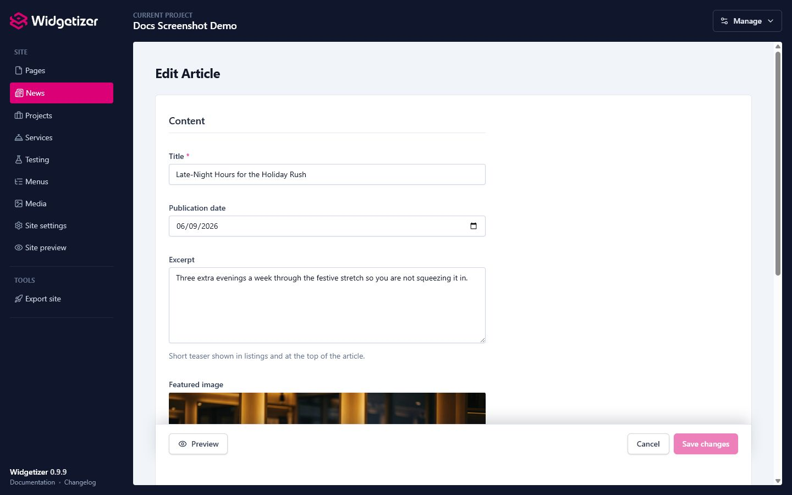
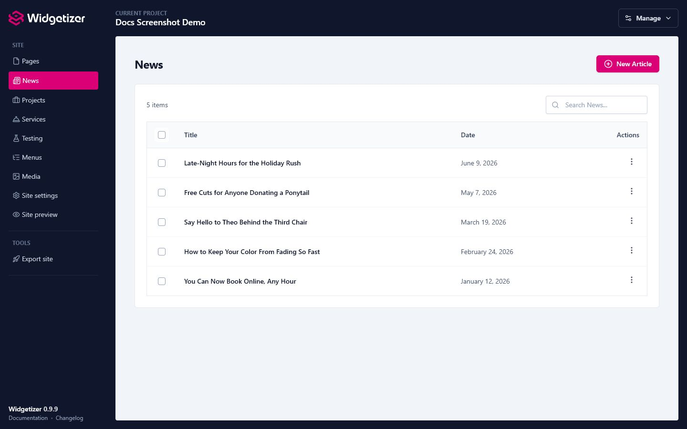

Collections are content types your theme provides, things like **News**, **Projects**, **Services**, or **Team**. Each collection holds many **items** of the same shape (every news article has a title, date, and body; every project has a name, image, and description). You fill in the items; the theme decides how they look on your site.

# Where Collections Come From

Collections are defined by your **theme**, not created by hand. When a theme ships collection types, they appear in the sidebar, one entry per type (e.g. "News", "Projects"). If your theme doesn't define any collections, you won't see this section, and that's normal.

> **Note:** Because collections come from the theme, you can't add or remove collection *types* yourself, only the items inside them. This is similar to how [themes](themes.html) define which widgets are available.

> **Tip:** Comfortable with code? Collection types live in the theme. If you build or customize your own theme, see [Collections (Authoring)](theme-dev-collections.html) for how to define a collection type, its fields, and optional item pages.

# Adding an Item

1. Open the collection from the sidebar (e.g. **News**).
2. Click the **"New"** button, named after the item type (for example **"New Article"**).
3. Fill in the fields. These are defined by the theme: a news article might have Title, Publication Date, Excerpt, Featured Image, and Body.
4. Click **"Create"**. When you edit an existing item later, the button is **"Save changes"**.

The **Title** field (whichever field the theme marks as the title) also fills in the item's **Filename**, which becomes its web address. For example, an article titled "Summer Sale" is saved at `news/summer-sale`. You can change the Filename under **"More settings"**.

<figure class="doc-screenshot">
  
  <figcaption>Collection item editors are generated from the fields defined by the active theme.</figcaption>
</figure>

# Editing, Duplicating, and Deleting

From a collection's item list you can:

<figure class="doc-screenshot">
  
  <figcaption>Collection lists keep item search, creation, editing, duplication, and deletion in one place.</figcaption>
</figure>

- **Edit:** click an item to open it, change fields, and save.
- **Duplicate:** make a copy to use as a starting point for a similar item.
- **Delete:** remove an item (with confirmation). You can also select several and delete them together.
- **Reorder:** when the theme uses manual ordering, drag items to set the order they appear on the site.

# Item Pages

Some collection types give each item its **own page** on your published site (for example, a full article page for each news item). Others are "list only": their items appear in a grid or list somewhere but don't have standalone pages. This is set by the theme.

For types with item pages:

- **Preview:** once an item is saved, use the **Preview** button to see its page exactly as it will look on your site.
- **SEO settings:** like regular [pages](pages.html), each item has optional meta description, social title, social image, canonical URL, and indexing controls under **"More settings"**. These default to sensible values, so you only set them when you want to override.

### The Featured Image as Share Image

In Arch's **News**, **Projects** and **Services**, the item's **Featured image** is also the image shown when the item is shared on social media, as long as its own **Social Media Image** is empty. Set a Social Media Image only when you want a different picture for sharing.

> **Note:** Projects created before Arch 0.9.10 get this by applying the Arch theme update. See [Theme Updates](themes.html#theme-updates).

# How Items Appear on Your Site

Your theme places collection content using its own widgets, for example a "News Grid" widget that lists recent articles, or a "Projects" gallery. Add that widget to a page in the editor and it pulls in your items automatically. The exact widgets available depend on your theme.

When a list grows long, you can split it across several pages — see [Splitting a long list into pages](pages.html).

# Collections in Other Languages

On a [multilingual site](languages.html), each collection's item list shows a tab for each language. Each tab lists only that language's items, and a new item is created in the language whose tab is open.

To write an item in another language, use the language chips on its row (a filled chip opens that version, a dashed one creates it), or the language menu at the top of the item editor. The new version starts as a copy of the saved item. After that, each version has its own fields, Filename, SEO settings and place in the manual order.

A listing on a page shows only the items in that page's language. If a language has no items yet, its listing is empty; it doesn't borrow items from the default language.

> **Note:** **Duplicate** makes a separate item, not a translation. Use the language chips or menu when you want the same item in another language.

# Exporting

When you [export](export.html) your site, every item that has its own page becomes an HTML file (e.g. `news/summer-sale.html`, or `el/news/...` for another language) and is included in your `sitemap.xml`. List-only items are rendered wherever the theme's widgets display them. Your item content lives in your project files and is never touched by [theme updates](themes.html#theme-updates).
