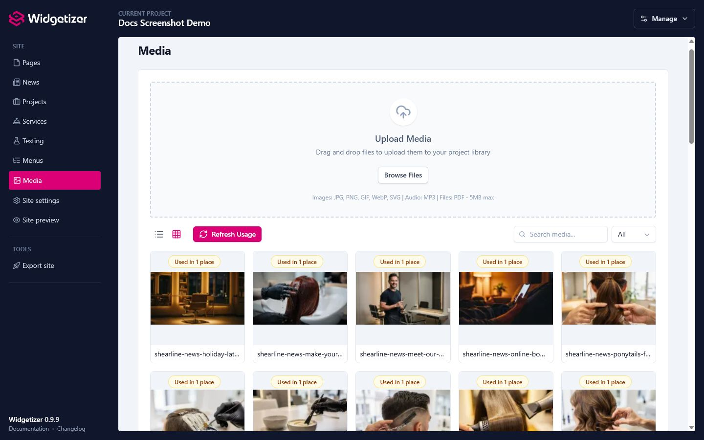
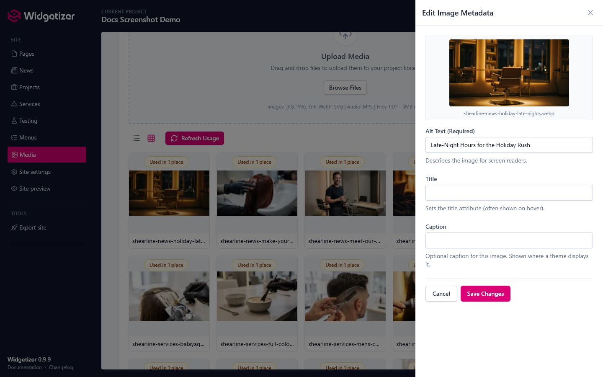

The Media Library is your central hub for all the images used in your website. Widgetizer automatically optimizes your images and tracks where they're being used to help you manage your media efficiently.

# Uploading Files

### Drag and Drop

1. Go to the **Media** page
2. Drag files from your computer into the upload zone
3. Or click **"Select Files"** to browse

You can upload multiple files at once. Widgetizer will process them in batches, and new uploads appear at the top of the library.

### Supported File Types

**Images:**

- JPEG/JPG
- PNG
- GIF
- WebP
- SVG

**Documents:**

- PDF: for downloadable documents (brochures, menus, price lists) via `file`-type theme settings, such as the Resource List widget

**Audio:**

- MP3: for use with the Audio Player widget

**Video:**

- MP4: for use with the Video widget, which plays it with the browser's own player. Use H.264 video with AAC audio for playback everywhere; Widgetizer doesn't convert videos, and a file the visitor's browser can't decode shows a "can't be played" message. Videos count toward the same upload size limit as other files.

### Upload Limits

The maximum image upload size can be configured in [App Settings](settings.html). If a file exceeds the limit, it will be rejected with an error message.

# Automatic Image Optimization

When you upload an image, Widgetizer automatically creates multiple sizes for better website performance. This means your site loads faster because browsers can download the appropriate size for each screen.

### Generated Image Sizes

By default, Widgetizer creates these sizes:

- **Thumb** (150px wide) - For small previews
- **Small** (480px wide) - For mobile devices
- **Medium** (1024px wide) - For tablets and small desktops
- **Large** (1920px wide) - For large desktop screens

> **Note:** SVG images are never resized since they're vector graphics that scale perfectly at any size.

### Smart Size Generation

Widgetizer is smart about which sizes to create:

- If your original image is 800px wide, it won't create a "large" size (1920px would just be a stretched copy)
- Only sizes that are **smaller** than your original are generated
- When a public `large` variant exists, that variant becomes the largest browser-delivered image and the original file stays internal
- If no `large` variant exists, the original file can still be used as the top delivery asset
- This saves storage space and keeps your project lean

### Configuring Image Processing

You can customize how images are processed in [App Settings](settings.html) → **Media**:

**Image Quality:**

- Set a quality level from 1-100
- Higher quality = larger file sizes
- Lower quality = smaller file sizes (but may look worse)
- Recommended: 80-85 for a good balance

**Enable/Disable Sizes:**

- Turn individual sizes on or off
- For example, disable "Large" if you never need images that big
- Disabled sizes won't be generated, saving storage

**Customize Size Dimensions:**

- Change the maximum width for each size
- For example, set "Medium" to 768px instead of 1024px
- Useful for matching your theme's design

### When a Theme Defines Image Sizes

If your project uses a theme that defines its own image sizes in its manifest, those sizes **replace** the app-level settings for that project. In that case:

- The image sizes (and optional per-size quality) come from the theme
- The **Image Sizes** controls in [App Settings](settings.html) are hidden for that project; a notice explains that image sizes are managed by the theme
- Thumbnails for the media library are still generated
- Other media settings (upload limits, global image quality) in App Settings still apply

See [Themes](themes.html) for how themes work and [Settings](settings.html) for app-level options.

# Viewing Your Media

### Grid View

Shows your files as thumbnail cards. Great for browsing images visually.

<figure class="doc-screenshot">
  
  <figcaption>Grid view is useful for scanning image-heavy libraries and checking usage badges at a glance.</figcaption>
</figure>

### List View

Shows your files in a table with detailed information (filename, size, type, dimensions, upload date).

Switch between views using the toggle buttons in the toolbar.

### Searching

Use the search bar to filter files by filename. The search updates in real-time as you type.

### Filtering by Type

Use the type filter dropdown to filter files by type.

# Managing Files

### Editing Metadata

Each file can have metadata for accessibility and SEO:

1. Click the **pencil icon** (Edit) on any file
2. Add or update:
   - **Alt Text**: Describes the image for screen readers and SEO (required)
   - **Title**: Optional title text, often shown on hover
   - **Caption**: Optional text shown under the image wherever the theme displays captions (images only)
3. Click **"Save Changes"**

<figure class="doc-screenshot">
  
  <figcaption>The metadata drawer lets you add accessibility and SEO text without leaving the media library.</figcaption>
</figure>

> **Tip:** Always add alt text to images for better accessibility and SEO.

### Captions in Arch

Arch shows an image's caption:

- Under the **Image** widget
- Under the featured image on News, Projects, and Services item pages
- Under each image of a project or service gallery
- In the **Gallery** widget, when an image block has no caption of its own
- In the **Masonry Gallery** lightbox, when an image block has no title of its own

Images inside rich text don't show captions. Existing projects get captions after applying the Arch 0.9.10 [theme update](themes.html).

### Descriptions in Other Languages

On a site with more than one [language](languages.html), the metadata drawer has a **Language** list at the top. The file itself is shared by every language; pick a language to give it its own alt text, title, and caption. A field you leave empty uses the main language's text, which is shown greyed out as a hint.

### Deleting Files

#### Single Delete

1. Click the **trash icon** (Delete) on any file
2. Confirm the deletion

#### Bulk Delete

1. Check the boxes next to files you want to delete
2. Click **"Delete Selected"**
3. Confirm the deletion

### Delete Protection

Widgetizer tracks where every file is used. **You cannot delete a file that's currently being used** in:

- Page content (widgets, rich text, and the page's social media image)
- Header and footer widgets
- [Collection](collections.html) items, including their social media image
- Theme settings, such as the site icon
- The logo in your project's business details

This covers every language of your site. If you try to delete a file in use, you'll see an error message showing where it's used.

Before deleting, Widgetizer checks your saved content again, so a file is protected even if its usage badge is out of date.

# Usage Tracking

Widgetizer automatically tracks where your media files are being used. This helps prevent you from accidentally deleting images that are live on your site.

### How It Works

- When you save a page, collection item, theme settings, or project details, Widgetizer scans the content for media files
- Files are marked as "used in" those places, with the language named when it isn't the main one
- The Media Library shows usage badges on each file

### Usage Badges

Files in both grid and list view display a badge when they're in use:

- No badge: File isn't being used anywhere
- "Used in N place(s)" badge: hover the badge to see exactly which pages, collection items, or global widgets reference it

### Refreshing Usage

If you think the usage tracking is out of sync, you can manually refresh it:

1. Click the **"Refresh Usage"** button in the toolbar
2. Widgetizer will rescan all content and update the usage information

# File Organization

### File Naming

When you upload a file, Widgetizer:

1. Converts the filename to a URL-friendly format: lowercase, with spaces, underscores, and punctuation turned into hyphens so the words stay readable
2. Converts accented letters and other alphabets to plain Latin letters (names that can't be converted become `image` or `file`)
3. Shortens very long names to 60 characters, plus the extension
4. Checks if that filename already exists (ignoring upper and lower case) and, if it does, adds a number (e.g., `my-image-1.jpg`, `my-image-2.jpg`)

**Examples:**

- "My Awesome Photo.JPG" is stored as `my-awesome-photo.jpg`
- "logo (final)_v2.svg" is stored as `logo-final-v2.svg`
- "Café déjà vu.png" is stored as `cafe-deja-vu.png`

### Storage Location

- Images live at `/data/projects/your-project/uploads/images/`
- Documents, audio, and video (PDF, MP3, MP4) live at `/data/projects/your-project/uploads/files/`

Generated image sizes are stored with `-{size}` suffixes:

- `my-image-thumb.jpg`
- `my-image-small.jpg`
- `my-image-medium.jpg`
- `my-image-large.jpg`

PDF, MP3, and MP4 files are stored as-is, without variants or conversion. During export, `/uploads/files/` paths are rewritten to `assets/files/` in the output.

# Tips & Best Practices

- Resize very large photos before uploading; Widgetizer generates the responsive sizes from there.
- Use JPG for photos, PNG for graphics with transparency, and WebP when you can.
- Add alt text to every image for accessibility and SEO, and use descriptive filenames.
- Keep image quality around 80-85 in [App Settings](settings.html), and disable size variants you never use.
- Check a file's usage before deleting, and use bulk delete to clear out unused files.
