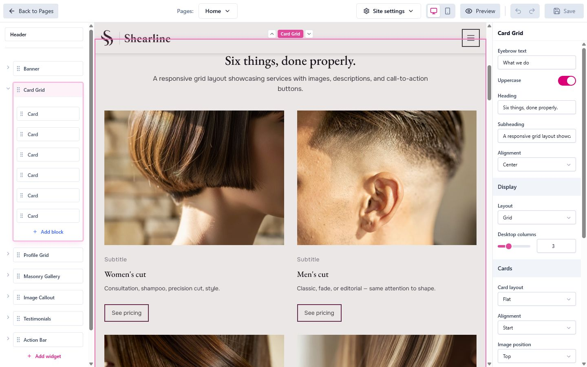

The page editor is where you build a page. You add widgets, fill them with your content, and arrange them in the order you want, while a live view of the page shows the result.

To open it, click a page's title on the [Pages](pages.html) list, or choose **"Design page"** in the page's actions menu.

<figure class="doc-screenshot">
  
  <figcaption>The widget list on the left, the live page in the middle, and the selected widget's settings on the right.</figcaption>
</figure>

# The Editor at a Glance

- **Widget list** (left): every widget on the page, with its blocks underneath. The header sits at the top and the footer at the bottom.
- **Canvas** (middle): a live view of the page as you edit it.
- **Settings panel** (right): the settings of whatever you've selected.
- **Top bar**: **Back to Pages**, a page switcher to jump to another page, the **Site settings** menu, **Desktop View** and **Mobile View**, **Preview**, **Undo**, **Redo** and **Save**.

# Selecting Widgets and Blocks

Click a widget in the widget list, or click it on the canvas, to select it. Click a block, such as one card in a grid, to select just that block. Its settings open in the settings panel.

With nothing selected, the settings panel says *"Select a widget to edit its settings"*.

### Adding and Arranging

- Click **Add widget** to pick a new widget. It goes where you clicked.
- Click **Add block** under a widget to add a block to it.
- Drag widgets and blocks in the widget list to reorder them, or use the up and down arrows that appear on a selected widget on the canvas.
- Double-click a selected widget's name to rename it. The name is only for you, to tell widgets apart in the list. You can also set it under **Internal name** in the settings panel.

### The Header and Footer

The header and footer are shared by every page in the same language. A change you make to them here shows up on all those pages. They always stay at the top and bottom, but you can add, reorder and remove their blocks like any other widget's.

### The Widget Menu

Right-click a widget in the widget list, or click its **Widget actions** button (⋮), to open its menu:

- **Copy widget**: keeps a copy you can paste on this page or another page of the same project.
- **Paste after this widget**: inserts the copied widget right after this one. You can also paste from **Add widget**.
- **Duplicate widget**: places a copy right after the original.
- **Delete widget**: removes it straight away, without asking. Use **Undo** if you change your mind.

# The Settings Panel

The settings panel shows the selected widget's or block's settings, grouped under headings. Every change shows on the canvas immediately.

A widget with unsaved changes gets a small amber dot in the widget list.

Some widgets that list collection items, such as a News list, have extra settings: **Main News page** under **Collection**, and **Split into pages** just above the number of items. See [Pages](pages.html#blog-and-collection-pages).

# Site Settings in the Editor

The **Site settings** menu in the top bar opens your theme's settings (colors, typography, and so on) in the settings panel, without leaving the page. They are the same settings as on the **Site settings** screen, and they apply to the whole site.

Site settings you change in the editor are saved together with the page, by **Save** or autosave, and **Undo** covers them too.

# Saving

Click **Save**, or press <kbd>Ctrl</kbd>+<kbd>S</kbd> (<kbd>Cmd</kbd>+<kbd>S</kbd> on a Mac). The button reads **Saving...** while it works and is greyed out when there's nothing to save.

### Autosave

Widgetizer also saves for you. A minute after your last change, it saves automatically. Each new change restarts that minute, so it never saves in the middle of your work. There is nothing to turn on. If an autosave fails, Widgetizer quietly tries again later.

If you try to leave the editor with unsaved changes, Widgetizer asks first. **Keep editing** takes you back; **Discard changes** throws the changes away, including any unsaved Site settings changes.

# Undo and Redo

Click **Undo** or **Redo** in the top bar, or use the keyboard shortcuts below.

- **What it covers:** widgets and blocks on this page, the header and footer, and Site settings you change in the editor.
- **Saving doesn't clear it.** You can still undo after a save or an autosave. Undoing a saved change makes the page unsaved again, and the next save stores the undone version.
- **Back to where you were.** If you undo everything back to the last saved version, there's nothing to save, and the **Save** button turns grey again.
- **Typing is one step.** Quick changes to the same value, like typing a heading or dragging a color, count as one step, so one undo takes back the whole word.
- **When it starts over:** opening another page starts a fresh history. Widgetizer remembers up to 150 steps.

While you're typing in a field, the undo shortcut undoes your typing in that field, as usual. Click outside the field to undo whole steps.

# Keyboard Shortcuts

| Shortcut | What it does |
| --- | --- |
| <kbd>Ctrl</kbd>+<kbd>S</kbd> (<kbd>Cmd</kbd>+<kbd>S</kbd>) | Save |
| <kbd>Ctrl</kbd>+<kbd>Z</kbd> (<kbd>Cmd</kbd>+<kbd>Z</kbd>) | Undo |
| <kbd>Ctrl</kbd>+<kbd>Shift</kbd>+<kbd>Z</kbd> (<kbd>Cmd</kbd>+<kbd>Shift</kbd>+<kbd>Z</kbd>) or <kbd>Ctrl</kbd>+<kbd>Y</kbd> | Redo |
| <kbd>Delete</kbd> or <kbd>Backspace</kbd> | Delete the selected widget or block |

<kbd>Delete</kbd> and <kbd>Backspace</kbd> do nothing while you're typing in a field. The header and footer themselves can't be deleted, only their blocks.

# Preview

The canvas shows your page as you edit it, unsaved changes included. Use **Desktop View** and **Mobile View** to see it at different screen sizes.

**Preview** opens the page on its own, without the editor, in a separate window or tab. That preview shows the **saved** version of your site, so save first if you want it to include your latest changes. You can click through links there to visit other pages and collection items, which also show their saved versions.

# Site Settings Screen

You can also change your theme's settings on the **Site settings** screen in the sidebar. It works like a form:

- **Save** stores your changes. It's greyed out until you change something.
- **Reset** undoes the changes you haven't saved yet, back to the last saved settings.
- Leaving with unsaved changes asks first. **Discard changes** throws them away.

The editor and the Site settings screen work on the same settings, so a change you discard in one is gone from the other too. A save that was already on its way still finishes.

If the settings were changed somewhere else since you opened them, such as in another window, Widgetizer keeps your changes on top of the newer settings and tells you, so you can check them and save again. If a theme update removed a setting you changed, Widgetizer tells you that change couldn't be saved.

See [Themes](themes.html#customization-within-a-theme) for what the theme settings cover.
