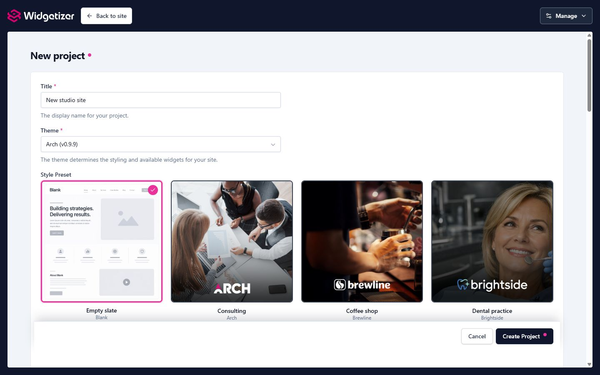

In Widgetizer, a **Project** is a container for your entire website. Each project holds all your pages, images, menus, and design settings. You can create and manage multiple projects, switching between them as needed.

# Understanding the Active Project

At any given time, one project is marked as **active**. This is the project you're currently working on. When you open the page editor or media library, you'll be working within the active project. Its name is shown at the top of the screen, under **Current project**.

> **Important:** A new project becomes the active project as soon as you create it.

# Creating a New Project

1. Open the **Projects** screen and click **"New project"**
2. On the **General** tab, fill in:
   - **Project Title** (required): The display name for your project
   - **Theme** (required): Choose a design theme for your project
   - **Style Preset** (if available): Some themes offer preset variants: different color schemes, typography, or demo content. When you select a theme that has presets, a visual card grid appears below the theme dropdown. Pick the preset that best matches your needs, or keep the default.
3. Fill in the other tabs now or later. They are all optional (see [The Project Form](#the-project-form) below).
4. Click **"Create Project"**

Widgetizer opens the new project straight away, ready to edit.

<figure class="doc-screenshot">
  
  <figcaption>Theme presets appear as visual cards during project creation when the selected theme provides them.</figcaption>
</figure>

### How Theme and Preset Relate

Think of project creation as: **Theme -> Preset -> Project**.

- **Theme** defines the design system, widgets, page templates, settings, and any collection types.
- **Preset** applies a starting style and optional starter content to that theme.
- **Project** is your editable copy. After creation, you can change content, settings, pages, menus, media, and collection items without changing the original theme or preset.

For the built-in library, many starter cards are presets of the default **Arch** theme. They may look like separate theme choices because they can include complete demo sites, but they share the same underlying theme and widget system. See [Themes](themes.html) for the full explanation.

# The Project Form

**New project** and **Project details** use the same form, split into tabs. One **Save** covers every tab. If something needs fixing, Widgetizer opens the tab with the problem, and a tab with an error shows a small dot.

You don't choose a folder name. Widgetizer picks one from the title and keeps it the same afterwards, even if you rename the project.

### General

- **Project Title**: The display name shown throughout Widgetizer.
- **[Theme](themes.html)**: Defines the look and feel, available widgets, templates, settings, and theme-owned content types for your site. **Note:** You cannot change the theme after creating a project, so choose carefully! In Project details the theme is shown with its version, but can't be changed.
- **Style Preset**: A starting point inside the chosen theme, with different colors, fonts, and/or demo content. Presets are only applied at project creation. Once created, your project is independent and fully customizable.
- **Notes**: Personal notes for your own reference. Useful for remembering what each project is for.
- **Receive Theme Updates**: Get notified when a new version of the theme is available.

### Site

- **Site Title**: Used in your site's browser tab titles, such as "Page Name - Site Title". It is separate from the project title, which only you see.
- **Site Address**: The address where your live site will be hosted (see [Site Address](#site-address) below).
- **Clean URLs**: Leave this off unless your host serves pages without `.html` (see [Clean URLs](#clean-urls) below).
- **Default Language**: The language your site is written in.
- **Other Languages**: Add more languages for a multilingual site. This list appears in Project details once the project exists. See [Languages](languages.html).

### Identity and Business Details

These describe who is behind the site. See [Site Identity and Business Details](#site-identity-and-business-details) below.

# Site Address

The **Site Address** is the full address of your live site, such as `https://example.com`. If your site lives in a folder of a larger website, include the folder: `https://example.com/site`. Widgetizer keeps that folder in every address it builds, so links in search results and social shares point to the right place.

The Site Address is used for:

- Full addresses in social media tags and SEO
- **Automatically creating `sitemap.xml`** when you export your site
- **Automatically creating `robots.txt`** with the sitemap location when you export
- The details search engines read about you (see below)

Enter only the address itself. A `?` or `#` part isn't accepted. If you're not sure yet, leave it empty and add it later. Without a Site Address, the export simply leaves out the items that need one.

# Clean URLs

Some hosts, such as Netlify or Cloudflare Pages, serve a page at `/about` instead of `/about.html`. Turn on **Clean URLs** on the **Site** tab if yours does.

When it's on:

- Links Widgetizer builds for you drop the `.html`: menus, links you pick in widget settings and rich text, and collection lists. Links to the homepage leave out `index.html`.
- The canonical address of each page, `sitemap.xml` and `robots.txt` drop the `.html` too.
- Exported files are still named `about.html`. Your host must serve them at `/about`.
- Links you typed by hand stay exactly as you typed them.

Not sure? Leave it off. Your site works on any host with the setting off.

# Opening a Project and Project Details

Click a project's name on the **Projects** screen to open it. If it isn't the active project yet, it becomes the active one.

To change a project's settings, open it first, then choose **Manage › Project details** at the top right. Project details always shows the active project.

1. Choose **Manage › Project details**
2. Update the fields you want to change, on any tab
3. Click **"Save Changes"**

> **Note:** Adding or removing a language takes effect straight away, not when you save. See [Languages](languages.html).

# Site Identity and Business Details

The **Identity** and **Business Details** tabs describe who is behind the site. Search engines like Google read these details, and your theme can show them on the site, for example in the footer. You can fill them in when you create a project or later in Project details.

### What Search Engines Can See

A yellow note beside the form shows what search engines can read: each detail gets a check once it's filled in, and **Add** next to a missing one takes you to the field. When a **Public Name** is set, the note shows it instead of the Site Title, since that's the name used. Search engines need your **Site Address** before they can read any of it.

### Identity

- **What best describes you?**: Choose Organization, Person, or the closest kind of local business (restaurant, hotel, dental practice, and so on). A local business also gets the **Business Details** tab.
- **Public Name**: The name people know you by. Leave it empty to use the Site Title.
- **Logo**: A logo for search engines and your theme, separate from the Site Icon. In Project details, choose it from your media library. If a Site Icon is set and no logo is, **Use the Site Icon** fills it in for you. When creating a project, choose an image file from your computer; it's added to the new project's media library. If the logo can't be added, the project is still created and you can add the logo later in Project details.
- **Email** and **Short Description**: One or two sentences about what you do.
- **Social Profiles**: Pick a network from **Add a profile…** and enter the full address, such as `https://instagram.com/yourname`.

### Business Details

- **Phone** and **Price Range** (optional, e.g. `€€` or `$10–30`)
- **Location Name**: Only if this location goes by a different name than the public name
- **Street Address**, **City**, **Region or State**, **Postal Code**
- **Country Code**: Two letters, e.g. `GR`, `US` or `DE`
- **Opening Hours**: Set each day to **Open**, **Closed**, or **Not stated**. Use **Add hours** for a split shift, such as 09:00–13:00 and 17:00–21:00.

If a value can't be used (an email without `@`, a profile address without `https://`), Widgetizer marks the field and doesn't save until you fix it.

### Showing Them on Your Site

In the Arch theme, add a **Business Details** block to the footer or to a **Contact Details** widget. It shows your address, phone and email, and opening hours, each of which you can switch off. Use its **Additional details** field for anything else, such as parking or appointment notes; it appears below the details. Day names and words like "Closed" follow the language of the page. A block with nothing to show keeps its title on the site, and in the preview it reminds you to add details.

> **Tip:** Social profiles you add here replace the social links in your theme settings wherever the Arch theme shows social icons. If you add none, the theme settings are used as before.

Duplicating, backing up and importing a project keeps these details, logo included.

# Setting the Active Project

To switch which project you're working on, click its name on the **Projects** screen, or:

1. Open the project's **actions menu** (⋮)
2. Choose **"Set as active project"**

The active project has an "Active" badge.

> **Note:** You can only have one active project at a time. Setting a new project as active automatically deactivates the previous one.

# Deleting a Project

1. Go to the **Projects** screen
2. Open the project's **actions menu** (⋮)
3. Choose **"Delete project"**
4. Confirm the deletion in the popup

### Important Notes

- **You cannot delete the active project**. Its menu shows "Cannot delete active project". Set another project as active first.
- **Deletion is permanent**. All pages, media, exported versions, and settings for that project will be removed.
- Consider downloading a backup before deleting it.
- If another program is holding one of the project's files (common on Windows), the project is still deleted, but a warning names the folder that couldn't be fully removed. Delete that folder yourself once the program lets go of it. Widgetizer never reuses that folder for a new project.

# Other Project Actions

These are all in each project's **actions menu** (⋮) on the Projects screen.

### Duplicating a Project

Choose **"Duplicate project"** to make a copy with all pages, settings, and media. The copy is named after the original with "(Copy)" added.

### Downloading a Backup

Choose **"Download backup"** to save the project as a ZIP file, for safekeeping or to move it to another Widgetizer installation.

> **Note:** This is different from site exporting. A backup is something Widgetizer can open again, while [site export](export.html) generates deployable HTML files.

### Importing a Backup

Click **"Import Backup"** at the top of the Projects screen and select a backup ZIP file. The imported project opens straight away as the active project.

A backup is checked before anything is created. One whose files are damaged is refused with a message naming the problem, and one that uses a newer backup format asks you to update Widgetizer first. Either way, no project is created and your backup file is untouched.

# Theme Updates for Projects

When a theme author releases an update, projects using that theme can receive the improvements.

### Identifying Projects with Available Updates

- On the Projects screen, the theme column shows an **"Update available"** label next to the theme's version
- The **Manage** menu shows a badge when updates are waiting

### Applying a Theme Update

1. Open the project (it becomes the active project)
2. Choose **Manage › Project details**
3. In the **Theme Update Available** box, which shows the current and new version, click **"Apply Update"**
4. The system updates your theme files while preserving your content

### What's Updated vs. Protected

**Updated:**

- Layout template, widgets, assets, snippets
- Theme settings schema (new settings are added)

**Protected (never changed):**

- Your pages and content
- Your media files
- Your existing menus and templates
- Your customized theme settings values

For more details on theme updates, see [Themes](themes.html#theme-updates).
